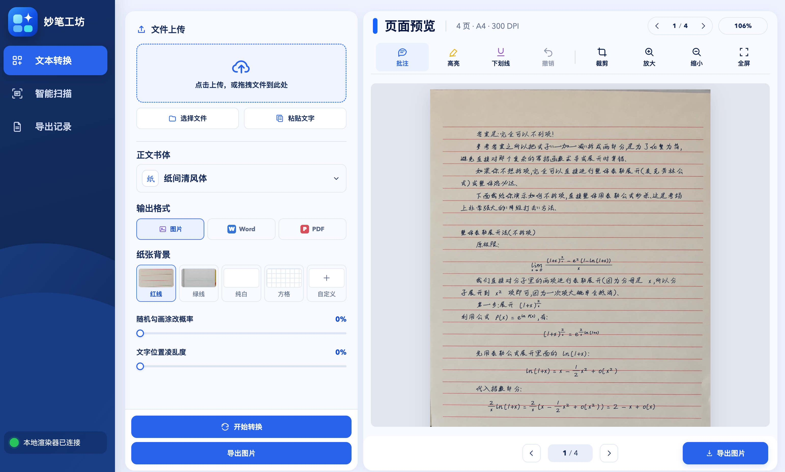

# ✍️ Miaobi Studio

[中文](README.md) | English

> Turn text, Markdown, and Word documents into realistic handwritten notes, or scan and organize paper documents. The app supports Chinese, English, mathematical formulas, customizable handwriting and paper, local preview, and export.



## Downloads

| System | Download |
| --- | --- |
| Windows | [Download for Windows](https://github.com/xiaoyoumi9924/handwritten-notes/releases/latest/download/Miaobi-Windows.zip) |
| macOS | [Download for macOS](https://github.com/xiaoyoumi9924/handwritten-notes/releases/latest/download/Miaobi-macOS-Apple-Silicon.zip) |
| Linux | [Download for Linux](https://github.com/xiaoyoumi9924/handwritten-notes/releases/latest/download/Miaobi-Linux.tar.gz) |

## Features

- Convert Markdown and Word documents while preserving headings, paragraphs, lists, tables, and common formulas.
- Choose handwriting styles and adjust font size, spacing, strokes, and paper backgrounds.
- Preview pages and add comments, highlights, and underlines, or crop pages.
- Scan and straighten document images with enhancement, black-and-white, brightness, grayscale, and inversion filters.
- Export images, Word documents, or PDFs and review export history.

## Getting started

1. Download and open the desktop app, or set up the local Web version below.
2. In **Text Conversion**, select a Markdown or Word file, or paste text. Choose a writing style, paper, and output format, then select **Start Conversion**. Review and export the result.
3. For paper documents, open **Smart Scan**, upload images (JPG, PNG, HEIC/HEIF, BMP, or WebP), adjust the crop and filter, and start scanning. Review and export the pages as images, Word, or PDF.

## Local Web setup (optional)

Install [Node.js](https://nodejs.org/), [Git](https://git-scm.com/downloads), and [Python 3.10+](https://www.python.org/downloads/), then run:

**macOS / Linux**

```bash
curl -fsSL https://github.com/xiaoyoumi9924/handwritten-notes/releases/latest/download/install.sh | bash
```

**Windows PowerShell**

```powershell
irm https://github.com/xiaoyoumi9924/handwritten-notes/releases/latest/download/install.ps1 | iex
```

The first run downloads the source, installs dependencies, and opens the app. It also installs the `miaobi` command; open a new terminal and run `miaobi` to start it again.

## Customize your handwriting

The project provides experimental tools based on [SDT](https://github.com/dailenson/SDT) for exploring a personal handwriting style. Prepare clear, unwatermarked individual character samples, then obtain SDT source, its environment, data, and pretrained weights from the original project. See the [handwriting research notes](training/new_chinese_handwriting/README.md) for sample preparation and trajectory generation. SDT source, datasets, and weights are not included in this repository; inspect generated characters for legibility.

## License

The project's original source code is licensed under the [MIT License](LICENSE). See [ASSET_LICENSES.md](ASSET_LICENSES.md) for fonts, handwriting resources, and third-party code.
