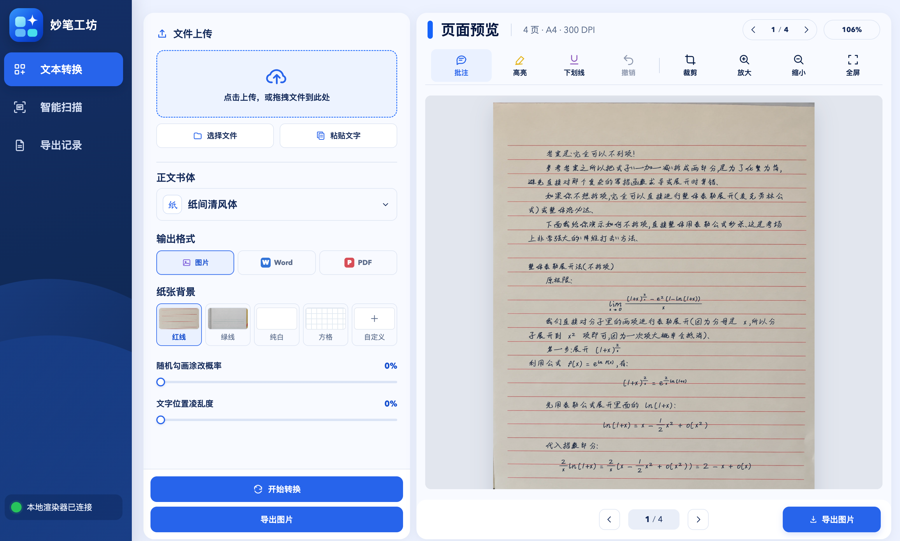

<div align="center">

# ✍️ 妙笔工坊 · Handwritten Notes

### Turn text into handwritten-style notes  
### 将文字转换为真实手写风格的笔记

<p>
  
  
  
  
</p>

</div>

妙笔工坊可以将文字、Markdown 和 Word 文档转换为手写风格笔记，也支持纸质文档扫描与整理。支持中文、英文和数学公式，可调整书体、纸张和排版，并在本地浏览器中预览和导出。

Handwritten Notes converts text, Markdown, and Word documents into handwritten-style notes. It also provides document scanning and image enhancement, with local preview and export.



## ✨ Features / 功能

- **Text conversion / 文本转换：** 输入文字或导入 Markdown、DOCX 文档
- **Handwriting layout / 手写排版：** 调整字体、字号、字距、纸张背景与排版
- **Page preview / 页面预览：** 逐页查看结果，添加批注、高亮和下划线
- **Document scanning / 智能扫描：** 裁切矫正、高清、黑白、增亮、灰度和反色处理
- **Export / 导出：** 导出图片、Word 或 PDF
- **Personal handwriting research / 个性化笔迹研究：** 提供基于 SDT 的实验工具与记录

## ⬇️ Download / 下载

| Platform | Download |
|---|---|
| Windows | [Windows release](https://github.com/xiaoyoumi9924/handwritten-notes/releases/latest/download/Miaobi-Windows.zip) |
| macOS | [macOS Apple Silicon release](https://github.com/xiaoyoumi9924/handwritten-notes/releases/latest/download/Miaobi-macOS-Apple-Silicon.zip) |
| Linux | [Linux release](https://github.com/xiaoyoumi9924/handwritten-notes/releases/latest/download/Miaobi-Linux.tar.gz) |

## 🚀 Run Locally / 本地运行

Install Node.js, Git, and Python 3.10+ first.

**macOS / Linux**

```bash
curl -fsSL https://github.com/xiaoyoumi9924/handwritten-notes/releases/latest/download/install.sh | bash
```

**Windows PowerShell**

```powershell
irm https://github.com/xiaoyoumi9924/handwritten-notes/releases/latest/download/install.ps1 | iex
```

首次启动会安装依赖并打开本地页面。以后可在终端运行 `miaobi` 启动。

The first run installs dependencies and opens the local interface. Later, run `miaobi` from a terminal.

## ✍️ Personal Handwriting / 定制笔迹

项目提供基于 [SDT](https://github.com/dailenson/SDT) 的个性化笔迹研究工具。训练数据、模型权重与第三方项目需按各自说明单独获取；本仓库不包含这些第三方资源。

The handwriting research workflow is based on SDT. Obtain its source code, datasets, and model weights separately and follow their respective licenses.

## 📖 Documentation / 文档

- [笔迹研究记录 / Handwriting Research Notes](training/new_chinese_handwriting/README.md)
- [资源许可说明 / Asset Licenses](ASSET_LICENSES.md)

## 📄 License / 许可

源代码采用 [MIT License](LICENSE)。字体、笔迹资源及第三方代码请遵循 [ASSET_LICENSES.md](ASSET_LICENSES.md) 中的说明。

Source code is released under the MIT License. Fonts, handwriting assets, and third-party components have separate terms listed in `ASSET_LICENSES.md`.
