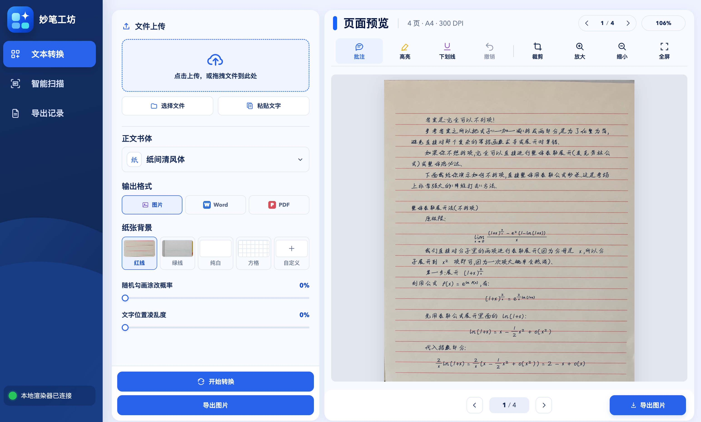

# ✍️ 妙笔工坊

> 将文字，Markdown 和 Word文档转换为真实手写风格的笔记，也可以扫描、整理纸质文档。支持中文、英文和数学公式，可调整书体、纸张和排版，在本地浏览器中预览并导出。



## 立即下载

| 系统 | 下载 |
| --- | --- |
| Windows  | [下载 Windows 版](https://github.com/xiaoyoumi9924/handwritten-notes/releases/latest/download/Miaobi-Windows.zip) |
| macOS| [下载 macOS版](https://github.com/xiaoyoumi9924/handwritten-notes/releases/latest/download/Miaobi-macOS-Apple-Silicon.zip) |
| Linux | [下载 Linux 版](https://github.com/xiaoyoumi9924/handwritten-notes/releases/latest/download/Miaobi-Linux.tar.gz) |

## 功能

- **文本转换**：输入或导入 Markdown、Word（DOCX），保留标题、段落、列表、表格和常见公式的排版。
- **手写排版**：提供多种字体，支持调整字号、字距、笔画和纸张背景。
- **页面预览**：逐页查看转换结果，可添加批注、高亮、下划线，以及裁剪页面。
- **智能扫描**：导入图片，裁切矫正纸面，使用智能高清、黑白、增亮、灰度或反色效果。
- **导出与记录**：文本转换和扫描结果支持导出图片、Word 或 PDF，可在导出记录中查看和筛选。

## 使用步骤

### 1. 打开程序

解压并打开上方下载的桌面应用。也可以按照[本地部署](#本地部署可选)从源码启动。

### 2. 转换手写文稿

1. 在「文本转换」中选择 Markdown 或 Word 文件，也可以直接粘贴文字。
2. 选择正文书体、纸张背景和输出格式；展开「更多排版参数」可继续调整。
3. 点击「开始转换」，在右侧逐页预览；需要时添加批注、高亮或下划线。
4. 确认效果后点击导出，选择图片、Word 或 PDF。

### 3. 扫描纸质文档

1. 切换到「智能扫描」，上传文档照片，支持 JPG、PNG、HEIC/HEIF、BMP 和 WebP。
2. 调整纸面裁切范围，选择智能高清、黑白、增亮、灰度或反色等效果，点击「开始扫描」。
3. 逐页检查结果，可旋转或添加标记，再选择图片、Word 或 PDF 导出。

## 本地部署web（可选）

如果希望在浏览器里使用 Web 版，可以在本地一键部署。先安装 [Node.js](https://nodejs.org/)、[Git](https://git-scm.com/downloads) 和 [Python 3.10+](https://www.python.org/downloads/)，然后在终端运行：

**macOS / Linux**

```bash
curl -fsSL https://github.com/xiaoyoumi9924/handwritten-notes/releases/latest/download/install.sh | bash
```

**Windows PowerShell**

```powershell
irm https://github.com/xiaoyoumi9924/handwritten-notes/releases/latest/download/install.ps1 | iex
```

第一次运行会下载源码、安装依赖并打开页面，同时安装 `miaobi` 命令；以后重新打开终端，运行 `miaobi` 即可启动。
## ✍️ 定制你的笔迹

想让生成的字更接近自己的笔迹？项目提供基于 [SDT](https://github.com/dailenson/SDT) 的个性化笔迹研究工具：收集并整理手写样本后，可使用 SDT 模型生成笔画轨迹，检查效果并探索制作自己的笔迹风格。

1. 准备清晰、无水印的手写样本，并整理成单字参考图。
2. 从 [SDT 项目](https://github.com/dailenson/SDT)获取源码并放到 `references/SDT/`，按其说明准备独立环境、数据和预训练权重；本仓库不包含这些源码、数据和权重。
3. 参考[笔迹研究记录](training/new_chinese_handwriting/README.md)运行样本处理和轨迹生成脚本，再检查生成字形的可读性。


## 许可

项目源代码采用 [MIT License](LICENSE)。字体、笔迹资源和第三方代码的授权信息见 [ASSET_LICENSES.md](ASSET_LICENSES.md)。
